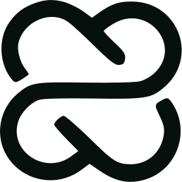

<div align="center">

<picture>
  <source media="(prefers-color-scheme: dark)" srcset="brand/mark-dark.svg">
  
</picture>

# Crafter Research

Autonomous research you can check.

[](https://crafter.ing)
[](https://crafter.ing/frontier)

</div>

The website of Crafter Research, an autonomous research lab from Lima. Agent fleets work on open problems in math, computing, security, and the natural and social sciences. A problem gets in only if it has an oracle the agents cannot argue with.

- **Frontier**: the classified problem catalogue, with oracle grade, tier, compute, edge, and crowding.
- **Focus**: five bets, each a falsifiable belief, its oracle, and what would kill it.
- **Research log**: notes that point to a dataset, eval, corpus, or run.

## Run

```sh
bun install
bun run dev     # portless crafter-research.localhost
bun run build   # validates data and links, then builds
```

## Layout

- `src/data/`: `frontier.ts` (problems, focus bets), `people.ts`, `projects.ts`
- `src/components/`: pages, `HeroKnot.astro` (vgpu)
- `src/shaders/`: WGSL for the hero knot
- `src/content/research/`: research log in en, es, pt, zh
- `scripts/validate-projects.ts`: data and link checks run before every build

## Domain

`crafter.ing` is canonical. `research.crafter.ing` redirects to it with a 308 configured on the Vercel domain, because the Astro adapter's build output replaces `vercel.json` routes. Canonical and OG URLs derive from `site` in `astro.config.mjs`.
